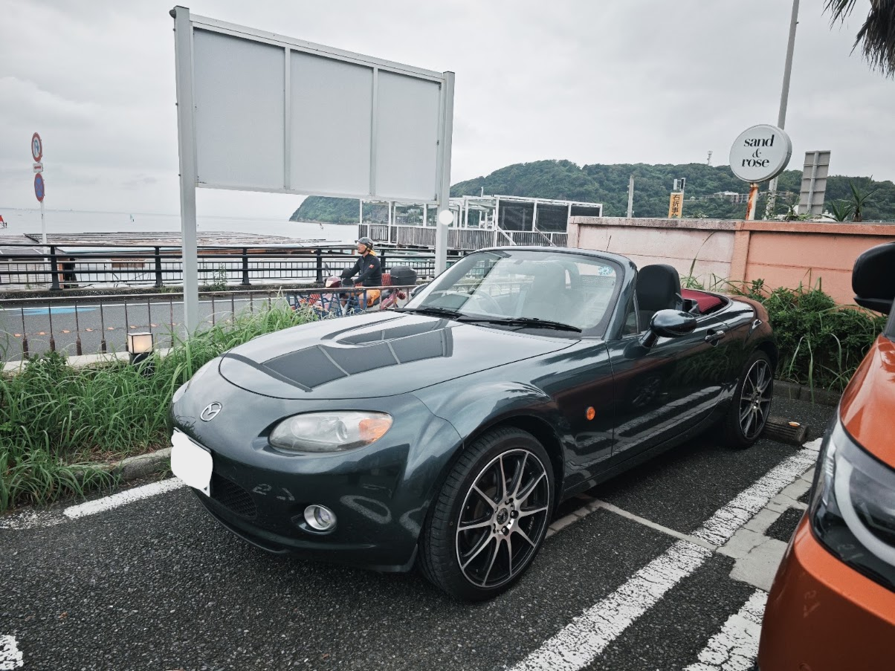
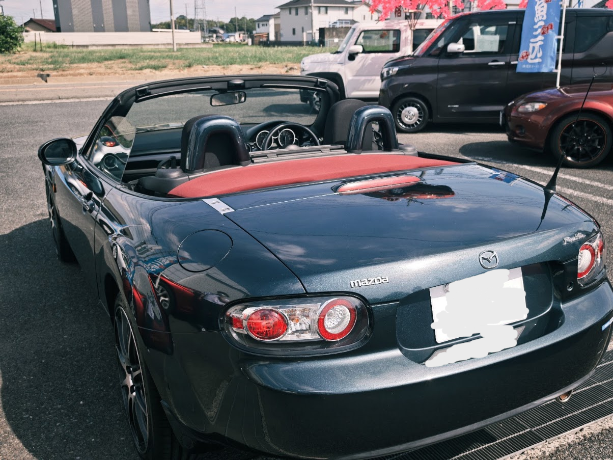
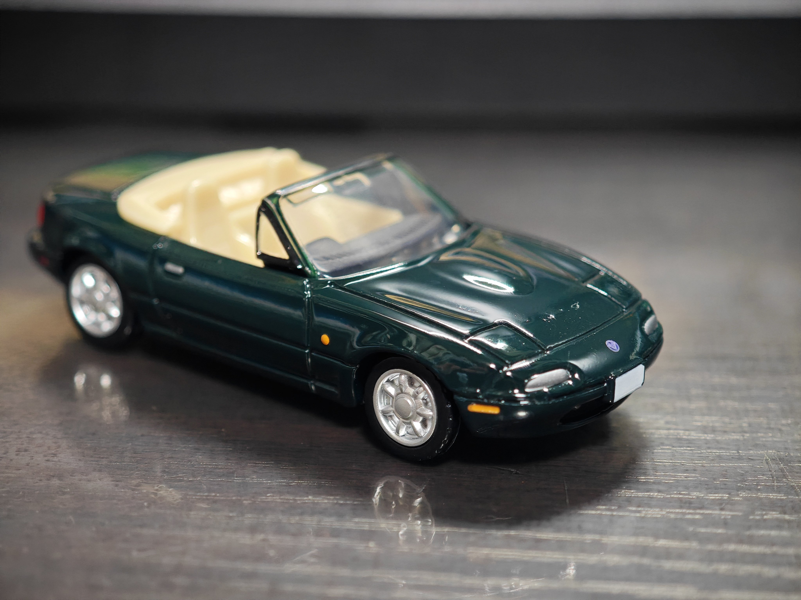

+++
title = '車を買った'
date = 2026-09-23T00:31:29+09:00
draft = false
categories = []
tags = []
image = ''
description = ''
ogpImage = ''
+++
車を，買いました．\
\
マツダ NCEC\
NC1ロードスターというやつです，

グレードはノーマルのノルディックグリーンマイカの幌車，6AT，社外の(おそらく)レッドベリートップの幌に最近交換済み\
12万キロ弱，BOSEオーディオの2DINナビ付き\
\
ケツ

## 購入までの経緯
### そもそもなぜ買ったのか
最近ちょこちょこレンタカーを借りて運転することが少し増えてきたな~，と関東圏住みなので車は生活に全く必要ないが，旅行等であると便利そう→どうせ生活に必要ないならファーストカーで2シーターとかトチ狂ってて良さそう\
NC1ロードスターが不人気で安いけど私はめっちゃ好きな顔してた，しかも保険料が安い(!)

### 納車までのタイムライン
- 1日2回グーネットとカーセンサーを漁る毎日
↓
- 埒が明かないしもういくつか見繕って旅行がてら名古屋に凸ろう(名古屋の中古車ディーラーに玉が多かった)
↓
- (7/18)行きの新幹線の中で，前日掲載の状態の良さそうな玉(当該個体)をグーネットで見つける
↓
- 現車確認に行ったら結構状態良いじゃん，しかも幌交換済みで車検整備と初期保証付いて本体65万+諸経費10万+タイヤ等の新品交換10万!?
↓
- でもそんな現金無いしな~，試しにローンとかって...?
↓
- 即時で通っちゃった，しかも月3万
↓
- ｴ~~~~~~
↓
- >>購入<<
- (7/25)家の近くで駐車場を契約+車庫証用の書類の請求
- (8/2)契約開始と同時に車庫証用の書類が届く
- (8/3)警察署に車庫証の申請を出す
- (8/6)警察署に車庫証の受け取り，車庫証と住民票，委任状をディーラーに送付する
- (8/28)車検が上がり，ナンバーが交付される．車検証の画像を送ってもらい任意保険を契約する
- (8/30)任意保険の開始，ケチって3000円の夜行バスで当日朝に名古屋入りする．現地(名古屋)で実車の引き渡し，関東まで自走で帰ってくる

なんだかんだで，間にお盆があったのと車検整備，県外ナンバーだったので各1週間ずつ，合計3週間余計に掛かった印象

約束時間まで暇だったのでトヨタ産業技術記念館のお土産コーナーで買ったユーノスロードスターのトミカ↓\
